# FactoryFlow ERP – Entity Relationship Diagram (ERD)

```mermaid
erDiagram
    TENANT ||--o{ BRANCH : has
    TENANT ||--o{ USER : employs
    TENANT ||--o{ ROLE : defines
    TENANT ||--o{ WAREHOUSE : owns
    TENANT ||--o{ CURRENCY : configures
    TENANT ||--o{ TAX_RATE : configures
    TENANT ||--o{ ACCOUNT : owns

    USER ||--o{ REFRESH_TOKEN : has
    USER ||--o{ LOGIN_LOG : records
    USER }o--o{ ROLE : assigned

    BRANCH ||--o{ WAREHOUSE : contains
    BRANCH ||--o{ PRODUCTION_LINE : houses

    CATEGORY ||--o{ RAW_MATERIAL : classifies
    CATEGORY ||--o{ PRODUCT : classifies
    UNIT_OF_MEASURE ||--o{ RAW_MATERIAL : measures
    UNIT_OF_MEASURE ||--o{ PRODUCT : measures

    PRODUCT ||--o{ BOM : has
    BOM ||--o{ BOM_ITEM : contains
    RAW_MATERIAL ||--o{ BOM_ITEM : used_in

    PRODUCT ||--o{ PRODUCTION_ORDER : manufactures
    BOM ||--o{ PRODUCTION_ORDER : follows
    PRODUCTION_LINE ||--o{ PRODUCTION_ORDER : runs_on
    PRODUCTION_ORDER ||--o{ PRODUCTION_MATERIAL_ISSUE : consumes
    PRODUCTION_ORDER ||--o{ PRODUCTION_LABOR_LOG : logs_labor
    PRODUCTION_ORDER ||--o{ PRODUCTION_OVERHEAD_LOG : allocates_overhead
    PRODUCTION_ORDER ||--o{ QUALITY_INSPECTION : inspected_by
    PRODUCTION_ORDER ||--o{ PRODUCTION_OUTPUT : produces

    MACHINE ||--o{ MACHINE_MAINTENANCE : requires
    PRODUCTION_LINE ||--o{ MACHINE : includes

    WAREHOUSE ||--o{ STOCK_BALANCE : holds
    WAREHOUSE ||--o{ INVENTORY_TRANSACTION : records
    INVENTORY_TRANSACTION ||--o{ INVENTORY_BATCH : tracks_fifo

    SUPPLIER ||--o{ PURCHASE_ORDER : receives
    PURCHASE_ORDER ||--o{ PURCHASE_INVOICE : billed_by
    PURCHASE_INVOICE ||--o{ SUPPLIER_PAYMENT : paid_by

    CUSTOMER ||--o{ SALES_ORDER : places
    SALES_ORDER ||--o{ SALES_INVOICE : billed_by
    SALES_INVOICE ||--o{ CUSTOMER_PAYMENT : paid_by

    JOURNAL_ENTRY ||--o{ JOURNAL_ENTRY_LINE : contains
    ACCOUNT ||--o{ JOURNAL_ENTRY_LINE : posted_to

    CASHBOX ||--o{ TREASURY_VOUCHER : records
    BANK_ACCOUNT ||--o{ TREASURY_VOUCHER : records
```

## Key Multi-Tenant & Financial Tables
1. **Tenants & Security**: `Tenants`, `Branches`, `Users`, `Roles`, `RolePermissions`, `UserRoles`, `RefreshTokens`, `LoginLogs`, `AuditLogs`, `Notifications`.
2. **Master Data & Inventory**: `UnitsOfMeasure`, `Categories`, `RawMaterials`, `Products`, `Warehouses`, `StockBalances`, `InventoryBatches`, `InventoryTransactions`.
3. **Engineering & Manufacturing**: `BillsOfMaterials`, `BomItems`, `ProductionLines`, `Machines`, `MachineMaintenances`, `Employees`, `ProductionOrders`, `ProductionMaterialIssues`, `ProductionLaborLogs`, `ProductionOverheadLogs`, `ProductionOutputs`, `QualityInspections`.
4. **Commercial**: `Suppliers`, `PurchaseOrders`, `PurchaseOrderItems`, `PurchaseInvoices`, `PurchaseInvoiceItems`, `Customers`, `SalesOrders`, `SalesOrderItems`, `SalesInvoices`, `SalesInvoiceItems`.
5. **Accounting & Treasury**: `Currencies`, `ExchangeRates`, `TaxRates`, `Accounts`, `JournalEntries`, `JournalEntryLines`, `Cashboxes`, `BankAccounts`, `TreasuryVouchers`.

